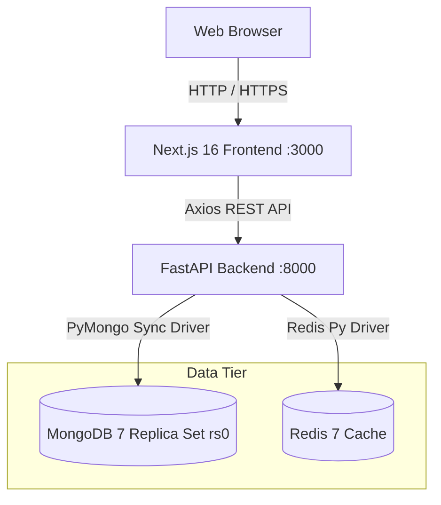
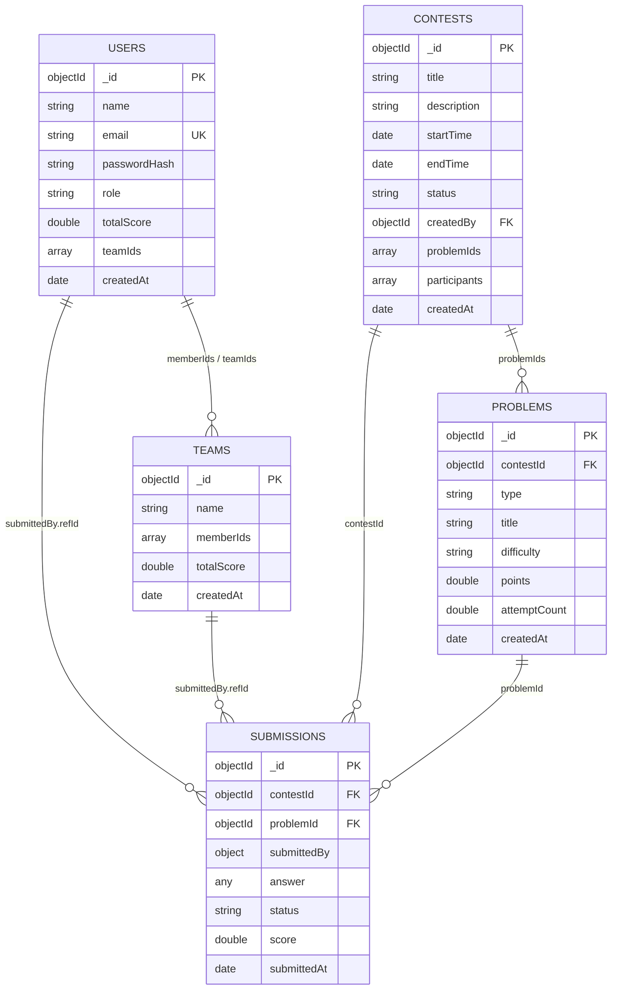
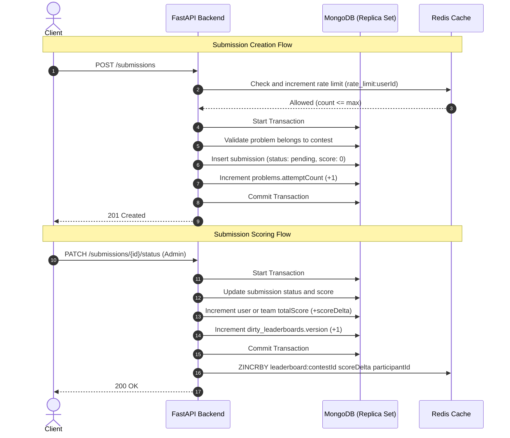
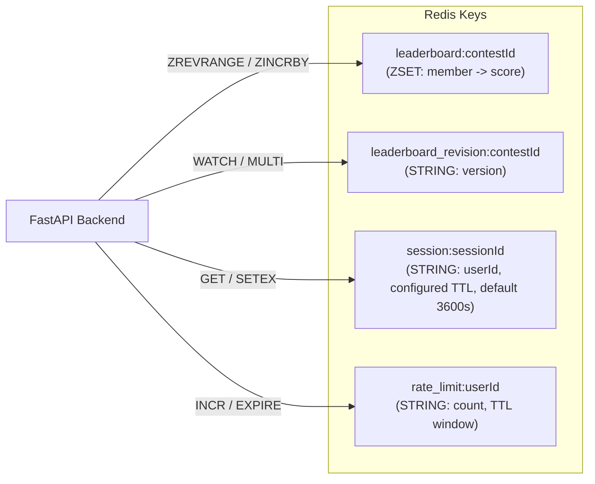

# System Architecture Specification

This document describes the system architecture, data models, and transaction flows of Rankstack.
Rankstack is a contest platform with live leaderboards, real-time submission evaluation, and team management.

## System Topology

The platform uses a tiered architecture.
Client applications communicate with a FastAPI backend.
The backend coordinates data persistence across MongoDB and Redis.



### Component Roles

1. **Next.js 16 Frontend (`app/`):**
   The frontend renders the user interface with React 19 and Tailwind CSS v4.
   It manages server state using TanStack Query v5.
   It manages client session state using Zustand v5.
   The frontend proxies session cookies to backend bearer tokens.

2. **FastAPI Backend (`api/`):**
   The backend serves REST API endpoints.
   It validates incoming requests and outgoing responses using Pydantic v2 schemas.
   It runs route handlers synchronously in a thread pool.
   This design prevents blocking the Python asyncio event loop.

3. **MongoDB Replica Set (`rs0`):**
   MongoDB functions as the durable system of record.
   The database runs as a single-node replica set named `rs0`.
   Multi-document ACID transactions require a replica set.
   Standalone MongoDB instances do not support multi-document transactions.

4. **Redis Cache:**
   Redis provides fast ephemeral storage.
   It stores live contest leaderboards in sorted sets.
   It stores user session tokens with inactivity expiration.
   It enforces submission rate limits with fixed time windows.

---

## Data Models

MongoDB stores records across five primary collections and one synchronization collection.
Each collection uses a server-side `$jsonSchema` validator defined in `api/db.py`.



### Collections and Schemas

#### 1. `users` Collection
Stores user accounts, authentication hashes, system roles, and team associations.
- **Required fields:** `name`, `email`, `passwordHash`, `role`, `createdAt`.
- **Role enumeration:** `participant`, `admin`.
- **Unique index:** `uniq_email` on `email` (ascending).

#### 2. `teams` Collection
Stores team entities and member identifiers.
- **Required fields:** `name`, `memberIds`, `createdAt`.
- **Index:** `by_member` on `memberIds` (ascending).

#### 3. `contests` Collection
Stores contest schedules, formats, participant registrations, and lifecycle states.
- **Required fields:** `title`, `startTime`, `endTime`, `status`, `createdBy`, `createdAt`.
- **Status enumeration:** `upcoming`, `live`, `ended`.
- **Index:** `by_status` on `status` (ascending).

#### 4. `problems` Collection
Stores contest problems using a polymorphic schema with a `oneOf` clause:
- **Base required fields:** `contestId`, `type`, `title`, `difficulty`, `points`, `createdAt`.
- **Type enumeration:** `mcq`, `coding`, `subjective`.
- **Difficulty enumeration:** `easy`, `medium`, `hard`.
- **Index:** `by_contest` on `contestId` (ascending).
- **Polymorphic constraints:**
  - `mcq`: Requires `options` array and `correctAnswer` string.
  - `coding`: Requires `testCases` array.
  - `subjective`: Requires `evaluationRubric` string.

#### 5. `submissions` Collection
Stores participant answers, evaluation results, and awarded scores.
- **Required fields:** `contestId`, `problemId`, `submittedBy`, `answer`, `status`, `score`, `submittedAt`.
- **Status enumeration:** `pending`, `correct`, `incorrect`, `partial`.
- **Compound index:** `by_contest_and_submitter` on `(contestId, submittedBy.refId)`.
- **Compound index:** `by_submitter` on `(submittedBy.refType, submittedBy.refId)`.
- **Index:** `by_problem` on `problemId` (ascending).

#### 6. `dirty_leaderboards` Collection
Tracks contest leaderboard cache invalidations and reconciliation revisions.
- **Required fields:** `_id` (matches contest `_id`).
- **Fields:** `dirty` (boolean), `version` (integer), `reconciledVersion` (integer or null).

---

## Multi-Document ACID Transactions

All operations affecting multiple documents execute inside ACID transactions in `api/services.py`.
Transactions use PyMongo client sessions (`client.start_session()`).
If any operation inside the transaction block fails, MongoDB rolls back all writes.



### Transaction Workflows

1. **Submission Creation (`create_submission`):**
   - Validates that the problem exists and belongs to the contest.
   - Inserts the submission record with `pending` status.
   - Atomically increments `problems.attemptCount` by 1.

2. **Scoring Update (`update_submission_status`):**
   - Reads the existing submission score.
   - Computes the score delta: `new_score - old_score`.
   - Updates `submissions.status` and `submissions.score`.
   - Atomically applies the score delta to the submitter's `totalScore` on `users` or `teams`.
   - Atomically increments `dirty_leaderboards.version` by 1 if the delta is non-zero.
   - Updates the live Redis leaderboard using `ZINCRBY`.

3. **Team Membership (`add_team_member` and `remove_team_member`):**
   - Updates `teams.memberIds` with `$addToSet` or `$pull`.
   - Updates `users.teamIds` with matching `$addToSet` or `$pull`.
   - Enforces a safety rule: a team must retain at least one member.
   - Raises `LastTeamMemberError` if a removal leaves the team empty.

4. **Team Deletion (`delete_team_transaction`):**
   - Decrements problem attempt counters for all team submissions.
   - Deletes all team submissions.
   - Deletes team references from all member user documents (`users.teamIds`).
   - Deletes the team from all contest participant lists (`contests.participants`).
   - Deletes the team document.
   - Marks affected contest leaderboards as dirty in `dirty_leaderboards`.
   - Deletes the team from active Redis leaderboards.

5. **Contest Deletion (`delete_contest_transaction`):**
   - Reverses awarded scores on submitter documents for all contest submissions.
   - Deletes all contest submissions.
   - Deletes all contest problems.
   - Deletes the contest document.
   - Marks the contest leaderboard dirty and deletes the Redis leaderboard key.

---

## Redis Ephemeral Architecture

Redis handles read-heavy and time-sensitive operations to protect the database.



### Key Patterns and Expiration Policies

| Key Pattern | Data Structure | Expiration (TTL) | Purpose |
|---|---|---|---|
| `leaderboard:<contestId>` | `ZSET` | Persistent during contest | Live rankings. The member is `userId` or `teamId` and the score is total points. |
| `leaderboard_revision:<contestId>` | `STRING` | Persistent during contest | Tracks the latest rebuilt version number to prevent stale writes. |
| `session:<sessionId>` | `STRING` | Configured TTL (default `3600s`) | Stores authenticated `userId`. The backend refreshes the TTL on authenticated activity. |
| `rate_limit:<userId>` | `STRING` | 60 Seconds (`60s`) | Counts submissions within the time window. The limit is 10 submissions. |

### Leaderboard Mechanics and Fault Recovery

1. **Live Updates:**
   FastAPI updates contest rankings in Redis with `ZINCRBY`.
   The frontend queries `GET /contests/{id}/leaderboard`.
   The route fetches rankings with `ZREVRANGE 0 (top-1) WITHSCORES`.

2. **Reconciliation and Invalidation:**
   If Redis restarts or drops data, the system rebuilds rankings from MongoDB.
   The route executes MongoDB analytical aggregation `leaderboard_for_contest`.
   The backend replaces the Redis leaderboard using an optimistic lock pipeline:
   - Watches `leaderboard_revision:<contestId>`.
   - Validates whether the current revision is newer than the database version.
   - Atomically deletes the old sorted set and adds new scores using `MULTI` and `EXEC`.

3. **Dirty Leaderboard Tracking:**
   When a deletion transaction occurs, MongoDB flags the contest in `dirty_leaderboards`.
   The flag forces reads to use MongoDB until Redis reconciliation completes.

### Browser Session Lifetime

The session token is held in an HttpOnly, SameSite=Lax browser cookie. A second
HttpOnly cookie records the TTL returned by login and the last cookie refresh.
`GET /api/session` validates the token with FastAPI, refreshes its Redis TTL,
returns the current user profile, and re-issues the browser cookie at most once
every five minutes. The client calls this route on load and every five minutes,
so active users keep both lifetimes aligned and role changes appear after a
reload. On 401/404 the cookies and client profile are cleared. Transient 5xx
or network failures preserve the cookie; protected pages show their own loading
or error state until the backend recovers. Successful authenticated proxy calls
can also refresh an overdue cookie after verifying the session.
Session responses and authenticated proxy responses use `Cache-Control: no-store`.
The proxy also uses `no-store` for errors and other public reads.

Contest pages disable joining after the scheduled end. Problem pages allow
submissions only during the scheduled window when the contest status is `live`.

### Frontend Polling and Invocation Budget

The contest detail and full leaderboard poll only while a contest is `live`, at
30-second intervals. An `upcoming` contest schedules one refetch at its start
time; an `ended` contest does not poll. Public contest-detail and leaderboard
GET responses are served through the Next.js proxy without credentials and
carry `Cache-Control: public, s-maxage=5, stale-while-revalidate=10`. The CDN
can absorb repeated public reads without mixing authenticated responses.

For a conservative 3-hour contest with 100 continuously focused leaderboard
tabs, two 30-second polls produce `100 × 2 × (10,800 / 30) = 72,000` proxy
requests. Session revalidation adds at most `100 × (10,800 / 300) = 3,600`,
for **75,600** before initial loads and other actions, or 7.56% of [Vercel
Hobby's one-million included monthly function invocations](https://vercel.com/docs/plans/hobby).
CDN hits can lower actual function invocations further. Monitor the Vercel
usage dashboard because other routes and contests share the same allowance.

---

## Analytical Aggregation Pipelines

The platform defines five analytical pipelines in `api/aggregations/pipelines.py`.
These pipelines compute complex reports across collections.

Two power the frontend admin dashboard: Average Score by Difficulty
(`useAverageScoreByDifficulty`) and Submission Count by Status
(`useSubmissionStatusByContest`), both in `app/src/hooks/api/use-aggregations.ts`.

The other three — Contest Leaderboard, Distinct Problems Solved per User,
and Team Performance — are **reporting-only**. They have no frontend
caller. They exist as `GET /aggregations/...` endpoints for ad hoc
inspection and as course deliverables that show the five required
pipeline shapes. The Contest Leaderboard pipeline (`leaderboard_for_contest`)
is the exception. It is also the live leaderboard's ranking source (see
[Leaderboard Mechanics and Fault Recovery](#leaderboard-mechanics-and-fault-recovery)
above). `GET /contests/{id}/leaderboard` calls it whenever that route
rebuilds from MongoDB.

### 1. Contest Leaderboard Pipeline
Calculates total scores for a specific contest, filtering out ungraded or
zero-score submissions, and breaks ties with the submitter's ID.
`submissionCount` is counted separately across every submission from each
ranked submitter, scored or not, so it matches `GET /contests/{id}/leaderboard`.
```
Pipeline stages:
$match (contestId, score exists and non-zero)
  -> $group (_id: {refId, refType}, totalScore: {$sum: "$score"})
  -> $project (refId, refType, totalScore)
  -> $sort (totalScore: -1, refId: -1)
  -> $limit (limit, only when a limit is requested; omitted to fetch every
     ranked submitter for a full Redis cache rebuild)
```

### 2. Average Score by Difficulty Pipeline
Calculates average submission scores grouped by problem difficulty.
```
Pipeline stages:
$group (_id: "$problemId", avgScore: {$avg: "$score"})
  -> $lookup (from: "problems", localField: "_id", foreignField: "_id", as: "problem")
  -> $unwind ("$problem")
  -> $group (_id: "$problem.difficulty", avgScorePerProblem: {$avg: "$avgScore"}, problemCount: {$sum: 1})
  -> $sort (_id: 1)
  -> $project (difficulty: "$_id", avgScorePerProblem, problemCount)
```

### 3. Submission Count by Status per Contest Pipeline
Counts submissions by evaluation status across all contests.
```
Pipeline stages:
$group (_id: {contestId, status}, count: {$sum: 1})
  -> $group (_id: "$_id.contestId", statusCounts: {$push: {status, count}})
  -> $lookup (from: "contests", localField: "_id", foreignField: "_id", as: "contest")
  -> $unwind ("$contest")
  -> $project (contestId, title: "$contest.title", statusCounts)
  -> $sort (title: 1)
```

### 4. Distinct Problems Solved per User Pipeline
Calculates the count of distinct problems solved by each user.
```
Pipeline stages:
$match (status: "correct", submittedBy.refType: "user")
  -> $group (_id: "$submittedBy.refId", problemsSolved: {$addToSet: "$problemId"})
  -> $project (userId: "$_id", distinctProblemsSolved: {$size: "$problemsSolved"})
  -> $lookup (from: "users", localField: "userId", foreignField: "_id", as: "user")
  -> $unwind ("$user")
  -> $project (userId, name: "$user.name", distinctProblemsSolved)
  -> $sort (distinctProblemsSolved: -1)
```

### 5. Team Performance Pipeline
Calculates team submission totals by joining member submissions.
```
Pipeline stages:
$lookup (
    from: "submissions",
    let: {memberIds: "$memberIds"},
    pipeline: [
      $match ($expr: {$and: [
        {$eq: ["$submittedBy.refType", "user"]},
        {$in: ["$submittedBy.refId", "$$memberIds"]}
      ]})
    ],
    as: "memberSubmissions"
  )
  -> $addFields (
      totalScore: {$sum: "$memberSubmissions.score"},
      submissionCount: {$size: "$memberSubmissions"},
      memberCount: {$size: "$memberIds"}
  )
  -> $project (name, memberCount, totalScore, submissionCount)
  -> $sort (totalScore: -1)
```
